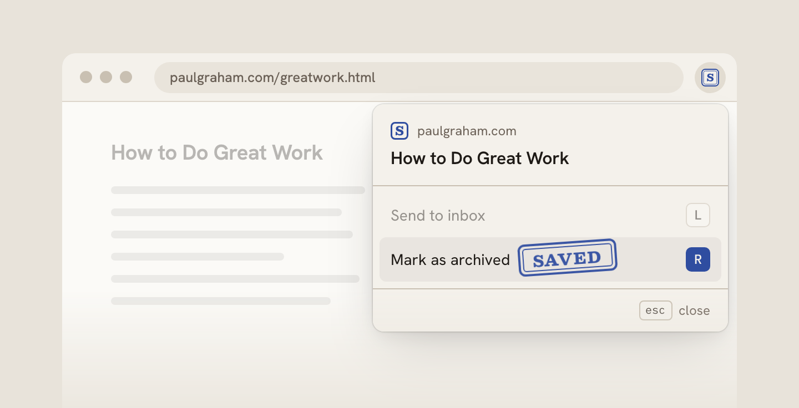

<p align="center">
  <picture>
    <source media="(prefers-color-scheme: dark)" srcset="brand/mark-dark.svg">
    
  </picture>
</p>

<p align="center">One tap saves a link to Notion. Claude tidies the title and tags after.</p>

<p align="center">
  <a href="#how-it-works">How it works</a> ·
  <a href="#deploy-your-own">Deploy your own</a> ·
  <a href="#install-the-chrome-extension">Chrome extension</a> ·
  <a href="#install-the-iphone-shortcut">iPhone Shortcut</a> ·
  <a href="#develop">Develop</a>
</p>

<p align="center">
  <picture>
    <source media="(prefers-color-scheme: dark)" srcset="brand/readme/hero-dark-saved.png">
    
  </picture>
</p>

Save links to a Notion database in one tap. Satchel is a tiny Cloudflare Worker you deploy yourself. You send it a URL and how you want it filed (send to inbox, mark as archived, or favorite), and it writes the row to Notion right away. A couple of seconds later, Claude cleans up the title and picks a few tags from the ones you already use.

It's for people who keep a reading log in Notion and want capture to be fast from anywhere: a Chrome extension, an iPhone share-sheet Shortcut, or plain `curl`. The Worker holds its own Notion token, so it doesn't care which Notion account your browser is logged into. A work browser can save to a personal database.

## What a save looks like

You send this:

```json
{ "url": "https://example.com/post?utm_source=newsletter", "status": "later" }
```

Satchel answers `{ "ok": true, "id": "<notion page id>" }` in a second or two, and a row shows up in Notion with the tracking params stripped and a placeholder title. Shortly after, the row gets a clean Title Case title and 1 to 3 tags.

| In the popup and Shortcut | Status sent | Archived | Favorite |
|---|---|---|---|
| Send to inbox | `later` | off | off |
| Mark as archived | `read` | on | off |
| Favorite | `favorite` | on | on |

Saving a URL that's already in the database updates its status, so saving it as `later` and then as `read` moves the same row. A re-save never re-runs Claude.

## How it works

1. `POST /save` checks the `x-satchel-key` header, cleans the URL, and looks for an existing row.
2. A new URL gets a new row (your title if you sent one, otherwise one built from the URL). A known URL gets its status updated. Then the Worker answers.
3. In the background, it looks up the real title (the page's `<title>`, or oEmbed for X posts, YouTube, Spotify and similar), asks Claude Haiku for a clean title and tags, and updates the row once. A new row also gets the article's preview image (or, without one, a one-paragraph summary) in its page body when the page has one, so Notion's gallery cards show it. When the Worker can't read a page itself (Substack often turns it away), a save from Chrome falls back to the image or description the extension read from the open tab.

If Claude fails, the looked-up title still lands. If you've edited the title in Notion since saving, Satchel leaves it alone.

## What you need

- **A Notion database** for your links, and permission to add a connection to it.
- **A Cloudflare account.** The free plan is enough.
- **An Anthropic API key** from [console.anthropic.com](https://console.anthropic.com). Each save costs a fraction of a cent. A new account has no credit, so add some first. Without it, `/health` still says `claude: ok`, but titles and tags never get cleaned up.
- **Node** (a current LTS release) to install and deploy.
- **For the iPhone Shortcut:** a Mac with the Shortcuts app, and [gitleaks](https://github.com/gitleaks/gitleaks) (`brew install gitleaks`).

## Deploy your own

1. **Clone and install.**

   ```sh
   git clone https://github.com/cdeweyx/Satchel.git
   cd Satchel
   npm ci
   ```

2. **Create a Notion integration and share your database with it.** At [notion.so/profile/integrations](https://www.notion.so/profile/integrations), make a new internal integration and copy its secret. That's your `NOTION_TOKEN`. Then open your database, click •••, then **Connections**, and add the integration. Skip this and every save fails with `notion_object_not_found`.

3. **Give the database these properties.** The types are fixed. The names are whatever `PROPS` in `src/config.ts` says:

   | Property | Type | What Satchel writes |
   |---|---|---|
   | `Name` | title | The clean title |
   | `URL` | url | The cleaned URL |
   | `Tags` | multi-select | 1 to 3 of your existing options |
   | `Archived` | checkbox | On for `read` and `favorite` |
   | `Favorite` | checkbox | On for `favorite` |
   | `Media` | checkbox | On for video, music and podcast links |

   Add the `Tags` options you want Claude to pick from. With no options, Claude doesn't run at all, so titles don't get cleaned up either. Satchel never adds tag options or properties. If your names differ (say `Title` instead of `Name`), edit the values in `PROPS` in `src/config.ts`. It's the only place Satchel names a property.

4. **Find your two Notion IDs and start the secrets file.** For the database ID, open the database as a full page (not inline on another page) and copy the 32 characters before `?v=` in its URL. The data source ID comes from the Notion API:

   ```sh
   curl -s https://api.notion.com/v1/databases/<database id> \
     -H "Authorization: Bearer <notion token>" -H "Notion-Version: 2026-03-11"
   ```

   Use the `id` under `data_sources` in the response. `scripts/deploy.sh` reads both IDs from a secrets file outside the repo, at `~/.config/satchel/secrets.env` (or set `SATCHEL_SECRETS_FILE` to another path). Create it and lock it down:

   ```sh
   mkdir -p ~/.config/satchel
   touch ~/.config/satchel/secrets.env
   chmod 600 ~/.config/satchel/secrets.env
   ```

   Then add the two IDs to it:

   ```sh
   NOTION_DATABASE_ID=<database id>
   NOTION_DATA_SOURCE_ID=<data source id>
   ```

   The IDs aren't secret, but they never go in the repo. `wrangler.jsonc` holds only the placeholder `set-at-deploy`, and the deploy script passes the real values in.

5. **Log in to Cloudflare** once:

   ```sh
   npx wrangler login
   ```

   For unattended deploys, put `CLOUDFLARE_API_TOKEN` and `CLOUDFLARE_ACCOUNT_ID` in the secrets file instead (make the token from Cloudflare's "Edit Cloudflare Workers" template).

6. **Add the three secrets and deploy.** Add these lines to the same secrets file:

   ```sh
   NOTION_TOKEN=<your Notion integration secret>
   ANTHROPIC_API_KEY=<your Anthropic API key>
   SATCHEL_KEY=<a long random string, e.g. from openssl rand -hex 32>
   ```

   `SATCHEL_KEY` is the password every client sends. Keep it private. Then deploy:

   ```sh
   npm run deploy
   ```

   `scripts/deploy.sh` copies only the three secrets into a private temp file, passes the two IDs as vars, and runs `wrangler deploy`. It prints key names, never values. Extra args pass through, so `npm run deploy -- --dry-run` works. Wrangler prints your Worker URL at the end, like `https://satchel.<you>.workers.dev`. Run the same command to redeploy after any change.

7. **Test it with two curls.** First, is the Worker up?

   ```sh
   curl -s https://satchel.<you>.workers.dev/health
   ```

   You should get `{"ok":true}`. Then save a link with your key:

   ```sh
   curl -s -X POST https://satchel.<you>.workers.dev/save \
     -H "content-type: application/json" \
     -H "x-satchel-key: <your SATCHEL_KEY>" \
     -d '{"url": "https://example.com/post", "status": "later"}'
   ```

   You should get `{"ok":true,"id":"<notion page id>"}` and a new row in Notion. The body is `{ "url", "title"?, "status", "image"?, "description"? }`: `title` is optional, and `status` is `later`, `read` or `favorite`. `image` (an https URL) and `description` are the page's preview, which the Chrome extension reads from the tab; the Worker uses them only when it can't get a preview itself, and drops an invalid one without failing the save.

### What `/health` tells you

- **No key:** `{"ok":true}` means the Worker is up. That's all it checks.
- **With the key** (add `-H "x-satchel-key: <your SATCHEL_KEY>"`): Satchel probes its three dependencies in parallel and answers 200 if all pass, 503 if any fails, or 401 if the key is wrong.

| Field | What it checks |
|---|---|
| `notion` | The token can read your data source. |
| `claude` | The Anthropic key works. |
| `oembed` | X's oEmbed endpoint answers (used for X post titles). |

Each field is `ok`, `auth_failed` (bad token or key), `not_found`, or `error <status>` (`error 0` means no response, usually a timeout). `notion: "not_found"` means the database isn't shared with your integration (add it under ••• then **Connections**) or `NOTION_DATA_SOURCE_ID` is wrong.

### When a save fails

Satchel never retries Notion. If Notion rejects a save, the Worker answers at once with a 502 and Notion's own error code. Sending it again is always safe, since a re-save updates the same row:

```json
{ "ok": false, "error": "notion_object_not_found" }
```

- `notion_object_not_found`: the database isn't shared with your integration, or `NOTION_DATA_SOURCE_ID` is wrong. Share it via ••• then Connections, and check that ID.
- `notion_unauthorized`: the Notion token is wrong or revoked.
- `notion_validation_error`: a property name or type doesn't match `PROPS` in `src/config.ts`.
- `notion_timeout` or `notion_unreachable`: Notion didn't answer in time. The row may already exist, and if so it won't get its clean title or tags. Sending it again is still safe.

The background step (title, tags, page body) doesn't retry either. If it fails, the row stays as it was saved.

Other errors are JSON too: 401 `unauthorized` (missing or wrong key), 400 `invalid_body`, `invalid_url` or `url_too_long`.

## Install the Chrome extension

1. Open `chrome://extensions` and turn on **Developer mode** (top right).
2. Click **Load unpacked** and pick the `extension/` folder in your clone.
3. Open Satchel's options, any of three ways: right-click the Satchel toolbar icon, then **Options**; open the popup and pick **Set up Satchel**; or on `chrome://extensions`, click **Details** on Satchel, then **Extension options**. If you don't see the icon, pin it from the puzzle-piece menu.
4. Fill in **Worker URL** (`https://satchel.<you>.workers.dev`) and **Satchel key** (your `SATCHEL_KEY`).
5. Click **Save**, then **Test**. It should list Notion, Claude and X oEmbed as `ok`. "Key rejected" means the key doesn't match.

Settings stay in that Chrome profile and never sync, so repeat these steps in each profile you save from.

To save a page:

- **Alt+Shift+S** (Option+Shift+S on a Mac) opens the popup. Rebind it at `chrome://extensions/shortcuts`.
- **L** sends to inbox, **R** marks as archived, and **F** favorites (for 3 seconds after R). Esc closes. Clicking a row works too.
- **A red "!" on the icon** means the last save failed after the popup closed, usually because of the key. The next successful save clears it.

## Install the iPhone Shortcut

The Shortcut puts Satchel in the iPhone share sheet. You build and sign it on a Mac.

1. On the Mac, from the repo root:

   ```sh
   npm run shortcut
   ```

   It ends with `signed dist/Satchel.shortcut`.

2. AirDrop `dist/Satchel.shortcut` to your iPhone. It opens on the Add Shortcut screen.
3. Answer its two questions: first the Worker URL base, without `/save` (`https://satchel.<you>.workers.dev`), then your `SATCHEL_KEY`. Tap **Add Shortcut**.

   If the questions don't show, add it anyway, open the Shortcut to edit it, and fill in the first two Text boxes: the Worker URL, then the key.

4. Optional: in any share sheet, scroll to the end of the action list, tap **Edit Actions…**, and move Satchel into Favorites so it sits near the top.

To save, tap Share, then **Satchel**, then **Send to inbox**, **Mark as archived** or **Favorite**. You'll see "Saved ✓", or "Satchel: not saved" with the error. Signing failures, re-signing and a manual build are in [`shortcut/README.md`](shortcut/README.md#install-on-your-iphone).

## See it as a gallery in Notion

Each new row gets the article's preview image as its page body when the page has one, or a short summary when it has only a description. Saved from Chrome, a page the Worker can't read (or one with no preview tags) still gets the image, description or first paragraph the extension read from the tab. An X post without a photo gets nothing. Add a **Gallery** view to your database and set its card preview to **Page content**, and each card shows that image. Rows that were in the database before Satchel don't have a page body.

## Configure

- **Property names:** edit `PROPS` in `src/config.ts` to match your database, then redeploy.
- **Database and data source IDs:** set at deploy time from your secrets file, never in the repo.
- **Tags:** Satchel reads the `Tags` options from your database, so add or rename options in Notion. Changes show up within about 10 minutes.

## Develop

```sh
npm ci              # also points git at .githooks
npm run check       # wrangler types, tsc, vitest. Offline, a few seconds.
npx wrangler dev    # local Worker on http://localhost:8787
```

- `wrangler dev` reads a gitignored `.dev.vars`. Fill it from your secrets file with a filtered grep, so nothing else comes along:

  ```sh
  grep -E '^(NOTION_TOKEN|ANTHROPIC_API_KEY|SATCHEL_KEY|NOTION_DATABASE_ID|NOTION_DATA_SOURCE_ID)=' ~/.config/satchel/secrets.env > .dev.vars
  ```

- Tests never hit the network. Any request a test didn't mock fails it, and tests use fake keys, never `.dev.vars`.
- The pre-push hook runs [gitleaks](https://github.com/gitleaks/gitleaks), so install it (`brew install gitleaks`) or pushes are blocked.

## Contributing

Issues and PRs are welcome. Three rules:

- Run `npm run check` before opening a PR.
- Tests never hit the network. Mock every outbound request.
- Never commit a secret, Notion ID or Worker URL.

## License

MIT. See [`LICENSE`](LICENSE).
